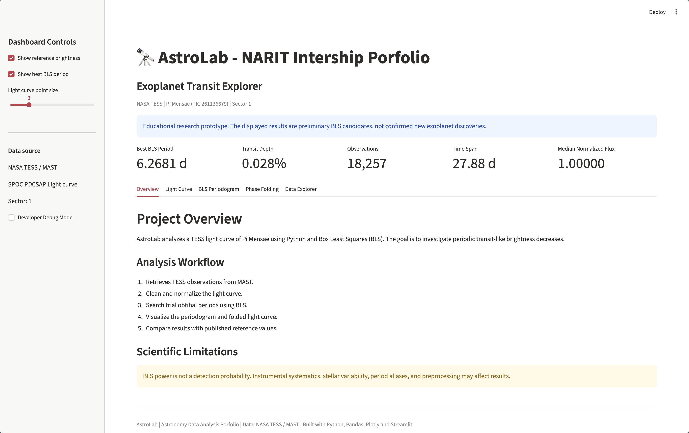
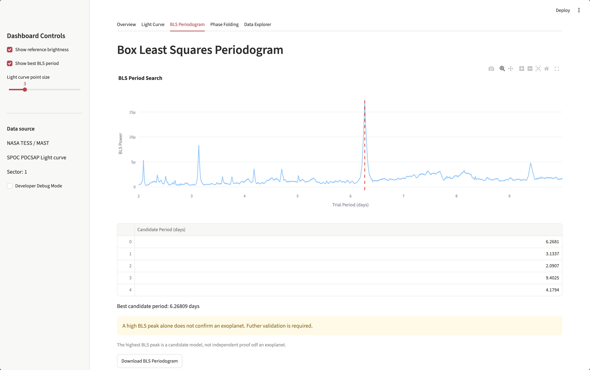

# AstroLab 🔭
### Interactive Exoplanet Transit Analysis Toolkit

A Python-based scientific data analysis project exploring periodic transit-like signals in NASA TESS light curves.

**Live Demo:** [Insert verified Streamlit URL]  
**Target:** Pi Mensae (TIC 261136679)  
**Data:** NASA TESS, Sector 1  
**Development:** 7-Day Portfolio Sprint



## 1. Motivation

Astronomical observations produce large volumes of time-series data. Identifying meaningful signals requires data preprocessing, statistical analysis, and careful interpretation.

AstroLab was developed to explore how data science and software engineering can support astronomical research.

## 2. Research Question

Can Box Least Squares identify periodic transit-like signals in a preprocessed TESS light curve of Pi Mensae, and how does the recovered period compare with a published reference value?

## 3. Features

- TESS light curve visualization
- Data cleaning and normalization
- Box Least Squares period search
- Phase-folded light curve visualization
- Interactive Plotly charts
- Dataset inspection and CSV export
- Automated testing with Pytest

## 4. Technologies

| Area | Technologies |
|---|---|
| Programming | Python |
| Data Processing | NumPy, Pandas |
| Astronomy | Lightkurve, Astropy |
| Visualization | Matplotlib, Plotly |
| Web Application | Streamlit |
| Testing | Pytest |
| Deployment | GitHub, Streamlit Community Cloud |

## 5. Data Source

The project uses publicly available observations from NASA's Transiting Exoplanet Survey Satellite (TESS), retrieved through the Mikulski Archive for Space Telescopes (MAST).

- Target: Pi Mensae
- TIC ID: 261136679
- Sector: 1
- Data product: SPOC PDCSAP

## 6. Methodology

1. Retrieve the target light curve.
2. Inspect missing values and data quality.
3. Normalize the stellar flux.
4. Apply preliminary outlier filtering.
5. Search trial periods using Box Least Squares.
6. Identify the highest-scoring BLS candidate.
7. Visualize the periodogram and phase-folded observations.
8. Compare the result with a published reference period.

## 7. Results

| Measurement | Result |
|---|---|
| Valid observations | [Actual value] |
| Best BLS period | [Actual value] days |
| Estimated transit depth | [Actual value] % |
| Estimated transit duration | [Actual value] days |
| Approximate reference period | 6.27 days |
| Absolute period difference | [Actual value] days |

**Interpretation:** [Describe whether the recovered period is consistent with the reference and what the phase-folded light curve shows.]



## 8. Installation

Install the required dependencies:

```bash
python -m pip install -r requirements.txt
```

Run the dashboard:

```bash
python -m streamlit run app.py
```

Run automated tests:

```bash
python -m pytest -v
```

## 9. Scientific Limitations

- The analysis uses a limited observation window.
- BLS models transit-like dips using a simplified box shape.
- Outlier removal may affect genuine astrophysical signals.
- Instrumental systematics and stellar variability may affect the periodogram.
- The analysis does not include comprehensive false-positive validation.
- The highest BLS peak does not independently confirm a planet.

## 10. Future Work

- Analyze multiple TESS sectors.
- Include measurement uncertainties.
- Improve preprocessing and transit validation.
- Support additional stellar targets.
- Add configurable BLS analysis to the dashboard.
- Develop a reusable astronomy data analysis API.

## Acknowledgements

This project uses publicly available NASA TESS data archived by MAST and open-source scientific Python libraries.

## Author

Natnicha Thongkampleo
Faculty of Information and Communication Technology  - Mahidol University